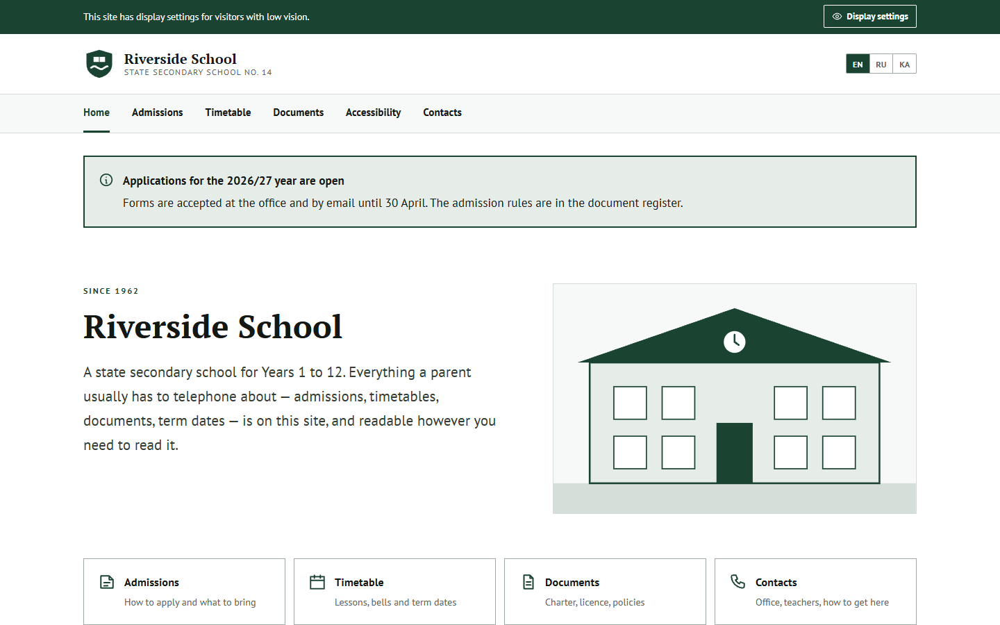

# School site, public sector

A state school site: WCAG AA accessibility, a low-vision mode and a document registry.

**Live:** https://dmitrii-mazurkevich.github.io/accessible-school-website/

## Built with

HTML, CSS, JavaScript, WCAG AA. Static site without a build step: open `index.html` or publish the folder to any hosting.
English and Russian versions with a language switcher, layout for phones and desktops.

## Author

Made by Dmitrii Mazurkevich: websites, WordPress and WooCommerce, analytics and AI automation.
Telegram https://t.me/dmitrii_pjm · dmitrymazurkevichse@gmail.com · [all works](https://dmitriiwebcraft.com)
